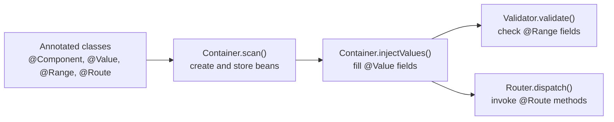

<h1 align="center">🥾 CampusBoot</h1>

<p align="center">
  <b>A tiny Spring-Boot-style framework built from scratch with custom annotations and Java Reflection.</b><br>
  <i>No external libraries. Pure Java 11+.</i>
</p>

<p align="center">
  
  
  
  
</p>

> 💡 **The big idea:** `@Component`, `@Value`, `@GetMapping` and friends are **not magic**. They are plain annotations that an engine reads at runtime. CampusBoot is that engine, in a few hundred lines.

**Author:** Mohammed Azraf Hossain Afsin · **ID:** IT 24054 · Dept. of ICT, MBSTU

---

## 📑 Table of Contents
1. [Features](#-features)
2. [How It Works (Big Picture)](#-how-it-works-big-picture)
3. [Project Structure](#-project-structure)
4. [The Four Annotations](#-the-four-annotations)
5. [Under the Hood](#-under-the-hood)
6. [Build and Run](#-build-and-run)
7. [Expected Output](#-expected-output)
8. [CampusBoot vs Spring Boot](#-campusboot-vs-spring-boot)
9. [Limitations](#-limitations)

---

## ✨ Features

| | Feature | What it does |
|---|---|---|
| 🧩 | **IoC Container** | Creates and stores beans for every class marked `@Component` |
| 💉 | **Value Injection** | Fills `@Value` fields from a config map (`String` and `int`) |
| ✅ | **Validation** | Checks `@Range` fields and reports every violation |
| 🧭 | **Routing** | Maps a path to a method marked `@Route` and invokes it |

---

## 🗺 How It Works (Big Picture)



Everything is driven by one idea: **read the annotation at runtime through reflection, then act on it.**

---

## 📂 Project Structure

```
CampusBoot/
├── Component.java      ┐
├── Value.java          │  The four custom annotations
├── Range.java          │
├── Route.java          ┘
├── Container.java        → scan, injectValues, getBean
├── Validator.java        → validate(Object) returns a list of violations
├── Router.java           → dispatch(Container, path)
├── GradeController.java  ┐
├── ReportPrinter.java    │  Starter / demo code
├── Student.java          │
├── Main.java             ┘
└── answers.txt           → Reflection questions
```

---

## 🏷 The Four Annotations

| Annotation | Applies to | Elements | Purpose |
|---|---|---|---|
| `@Component` | Class | `String value() default ""` | Marks a class to be created and managed by the container |
| `@Value` | Field | `String value()` | Injects a config value (by key) into the field |
| `@Range` | Field | `int min()`, `int max()`, `String message() default "Value out of range"` | Validates that an `int` is within `[min, max]` |
| `@Route` | Method | `String path()` / `String value()` | Maps a URL path to a method |

All four use `@Retention(RetentionPolicy.RUNTIME)`, so reflection can see them while the program runs.

> 📝 **Note on `@Route`:** the spec names the element `path()`, but the starter code writes `@Route("/hello")`, which Java only allows for an element named `value()`. `@Route` therefore declares **both** (default `""`), and `Router` accepts either `@Route("/hello")` or `@Route(path = "/hello")`.

### Usage sketch

```java
@Component
public class GradeController {

    @Value("app.name")
    private String appName;

    @Value("app.passMark")
    private int passMark;

    @Route("/hello")
    public String hello() { return "Welcome to " + appName; }

    @Route("/status")
    public String status() { return "Pass mark is " + passMark; }
}
```

---

## 🔬 Under the Hood

### 1️⃣ `Container.scan(Class<?>...)`: the IoC step
- For each class, call `getAnnotation(Component.class)`.
- If present → instantiate through the **no-arg constructor** and store it in a `Map<String, Object>`.
- Bean name = `value()`, or the **simple class name with a lowercase first letter** if empty.
- Otherwise → print `Skipped`.

### 2️⃣ `Container.injectValues(Map)`: the DI step
- For each bean, loop over `getDeclaredFields()`.
- For fields with `@Value`: `setAccessible(true)` → convert the string to `int` if needed → `set(...)`.

### 3️⃣ `Validator.validate(Object)`: the validation step
- For each `@Range` `int` field, read the value.
- If it is outside `[min, max]`, add `fieldName - message (actual: value)`.

### 4️⃣ `Router.dispatch(Container, path)`: the routing step
- Loop over beans and their methods, find a `@Route` matching the path, **invoke** it, and return the result.
- If nothing matches → `404 Not Found: <path>`.

---

## 🚀 Build and Run

```bash
javac -d out *.java
java -cp out Main
```

---

## 🖥 Expected Output

```text
[Container] Registered: gradeController (GradeController)
[Container] Skipped: ReportPrinter (no @Component)
[Container] Injected: app.name -> GradeController.appName
[Container] Injected: app.passMark -> GradeController.passMark

--- Validation ---
VIOLATION: score - Score must be between 0 and 100 (actual: 120)
OK
VIOLATION: semester - Value out of range (actual: 15)

--- Routing ---
[Router] /hello -> Welcome to CampusBoot
[Router] /status -> Pass mark is 40
[Router] /unknown -> 404 Not Found: /unknown
```

---

## ⚖️ CampusBoot vs Spring Boot

| CampusBoot | Spring Boot |
|---|---|
| `@Component` | `@Component` / `@Service` / `@Controller` |
| `@Value("app.name")` | `@Value("${app.name}")` |
| `@Range` | `@Min` / `@Max` (Bean Validation) |
| `@Route` | `@GetMapping` / `@RequestMapping` |

Real Spring also provides bean-to-bean dependency injection (`@Autowired`), automatic classpath scanning, bean lifecycle and scopes, AOP proxies, and an embedded HTTP server.

---

## 🚧 Limitations

- Beans need a **no-arg constructor**
- Only **`String` and `int`** are supported for `@Value`
- Route methods take **no parameters** and return **`String`**
- **No HTTP server**; `dispatch` is called directly

---

<p align="center"><i>Annotations are just metadata. Reflection brings them to life. ✨</i></p>
